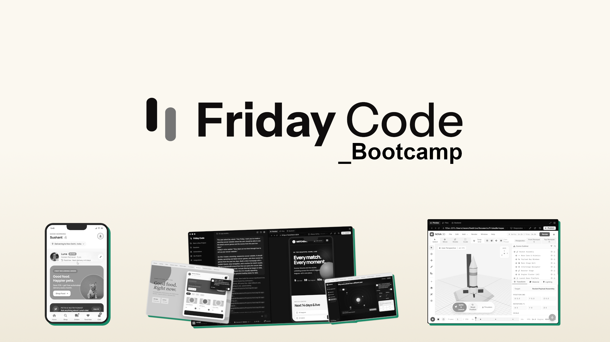

# Welcome to Friday Code Bootcamp

## From idea to a product people can use

This bootcamp is a practical course for turning ideas into working products with Friday Code. It is designed for indie hackers, founders, students, career switchers, and curious builders who want to make useful software without first becoming professional engineers. You will learn to direct agents, connect services, test real workflows, publish projects, and decide what to improve based on evidence. The point is not to make the most elaborate app or to let an agent make every decision. The point is to build something people can try, learn from what happens, and use your time and tools deliberately.

Friday is treated as an autonomous product operating system for research, design, coding, integrations, content, and recurring tasks. Capabilities and interface details can change, so the course focuses on durable habits rather than promises about specific buttons, screens, models, or integrations. Check current product documentation when your setup differs from an example.

## Who will benefit

You may have a clear product idea and need help turning it into a first version. You may have a business or community whose work is trapped in spreadsheets and repeated messages. Perhaps you want to test a niche, build a small SaaS, make a mobile companion, or create a portfolio that proves you can ship. You may already know some web concepts, or you may be new to code and want a guided way to learn by making things.

The course is especially useful if you are willing to stay close to users and make decisions. Agents can produce drafts and code quickly, but they cannot determine your values, confirm that a market exists, or take responsibility for handling someone’s data. Your judgment remains central. You decide which problem matters, what information is safe to share, how much to spend, what quality is acceptable, and whether a feature is ready for real people.

## What you should finish with

The bootcamp aims to help you:

- Ship multiple small products, including a live web or mobile project.
- Understand a repeatable loop: describe a goal, plan a small change, build, inspect, test, and refine.
- Use research and user feedback to improve product choices.
- Connect services such as a backend, deployment provider, code host, or payment provider when appropriate.
- Build at least one recurring system, such as a research digest, support triage, content workflow, or product maintenance routine.
- Explain how your agents and integrations are being used, what they can access, and where a person must review the work.
- Export and retain control of your code and make sustainable choices about operating costs.
- Present a portfolio of work to users, collaborators, or potential customers.

These are learning outcomes, not a guarantee of revenue, adoption, or app-store success. Those outcomes depend on the problem, execution, and market.

## The course approach

Each module centers on a concrete outcome. You will build a small version and put it in front of someone, learning to define the user, task, and boundaries; break requests into inspectable steps; and ask an agent to report assumptions and tests. You will check its work: a plausible screen does not prove that data saves, a payment is recorded, or an automation behaves safely.

The modules move from setup and first deployment toward full-stack products, mobile, research, distribution, video, automations, orchestration, production, and a final product system. Later work can build on earlier projects, but it does not have to. A focused project that solves one small problem is more useful than a sprawling idea that never reaches a real user.

Friday can accelerate work, but speed does not remove the need to verify facts or code. Review a plan before risky changes, keep edits small, ask what changed and how it was checked, and test the user journey yourself. When something fails, capture the symptom and ask for a diagnosis before requesting a broad rewrite.

## Prerequisites and setup

Basic familiarity with websites is helpful but not required. You should be comfortable installing desktop software, using files and folders, and managing accounts. A Mac or Windows computer is expected. Some projects use external accounts, API keys, paid plans, or services such as a code host, hosting provider, database, payment processor, email service, or media API. Availability, pricing, account requirements, and product features can change, so confirm them with the provider before relying on them.

Treat API keys and passwords as secrets. Do not paste them into public prompts, source code, screenshots, or a repository. Use each provider’s recommended secret-management mechanism, limit permissions where possible, and rotate a credential if it may have been exposed. Start with test or sandbox environments for payments and integrations. Do not connect an automation to real customers or send messages at scale until you have tested it with safe examples and reviewed what it will do.

You do not need to buy every tool or subscribe to every model mentioned. Choose the smallest set of services that supports your current project. Check costs, rate limits, usage rules, and data policies before sending information to a third party. Keep a simple record of recurring expenses and set provider limits or alerts where available. If you cannot confidently explain what a service can access, pause before granting it access.

## A manageable project cadence

The estimated course time is 20 to 24 hours. Work in short cycles:

1. **Choose a user and a job.** State who has the problem, what they are trying to do, and what makes the current method frustrating.
2. **Set a small finish line.** Describe one end-to-end task that a user can complete. Write down what is deliberately out of scope.
3. **Build a thin version.** Ask Friday to plan the work, then implement the essential path before adding secondary features.
4. **Check it.** Walk through the flow as a user, try valid and invalid inputs, and check the data or output where you can. Record failures.
5. **Show it to someone.** Ask a relevant person to use it without coaching. Watch where they hesitate and ask what they expected.
6. **Choose the next change.** Fix a blocker or test one meaningful improvement, then repeat.

At each module’s end, complete the project and an “invent” challenge: propose an unlisted use case, make a small prototype, and state what evidence would show its value. Weekly “Ship Something” challenges emphasize honest feedback over visual polish.

## How to use the modules

Read the goal and project first. Keep a working note for each product with its intended user, main workflow, current limitations, service dependencies, and next test. As you use Friday, save prompts that worked and note why they worked. A useful prompt describes the outcome, context, constraints, and acceptance checks; it does not need special wording. For instance, ask for a waitlist form that validates an email, explains what happens after submission, avoids duplicate signups where feasible, and reports how you can verify a successful save.

Use examples as patterns, not recipes. If an integration is unavailable, choose an equivalent or simulate it safely. Confirm current product options. For payments, personal information, outreach, or scheduled publishing, include human review and a way to stop the process.

Exporting code is part of ownership, not an emergency measure. Keep a copy you can access, learn how to inspect changes in your own editor, and use version control where possible. Before a major change, preserve a known working state. If you use a local model for cost or privacy reasons, check its capabilities and limitations, and do not treat local execution as a substitute for access controls, testing, or careful data handling.

## What success looks like

Success is a working product that solves a stated problem for someone, plus a clear account of what you learned. A small tool with a tested flow, sensible errors, measured costs, and honest limits is better than a long feature list without verified users. Record task completion, confusion, error recovery, and ongoing effort or cost.

Expect imperfect drafts, edge cases, outages, and tradeoffs. Reduce scope, protect data, test safely, and review consequential actions. Confidence comes not from eliminating uncertainty, but from turning it into a small experiment and a better product.

## Quick-start checklist

### What you are building

- This course helps you move from an idea to a real product using a practical build-test-learn loop.
- Learn the core rhythm: define a user, choose a small job, build, test, and improve.
- Use Friday as a directing tool, not a replacement for decisions about risk, privacy, or product value.
- Create a portfolio of working experiments, not just notes or mockups.

### Your workflow in 6 easy steps

1. Pick one real problem and write the user, job, and success metric in plain language.
2. Choose a tiny first version that can be tested quickly without extra complexity.
3. Ask Friday for a plan, assumptions, and risks before editing code or spending budget.
4. Build one path end-to-end and test it as a real user would.
5. Review the result, capture what happened, and pick the next improvement.
6. Ship a small, honest result and repeat the loop with evidence.

### Visual checklist

- ✅ User and problem are clear
- ✅ Scope is narrow enough to test
- ✅ Core workflow is defined before extra features
- ✅ Real validation happens before launch
- ✅ A next improvement is recorded for the next cycle

> Pro tip: treat every module as a build-test-learn loop. The goal is not perfection, it is clarity, evidence, and a usable result that can be improved with the next test.

