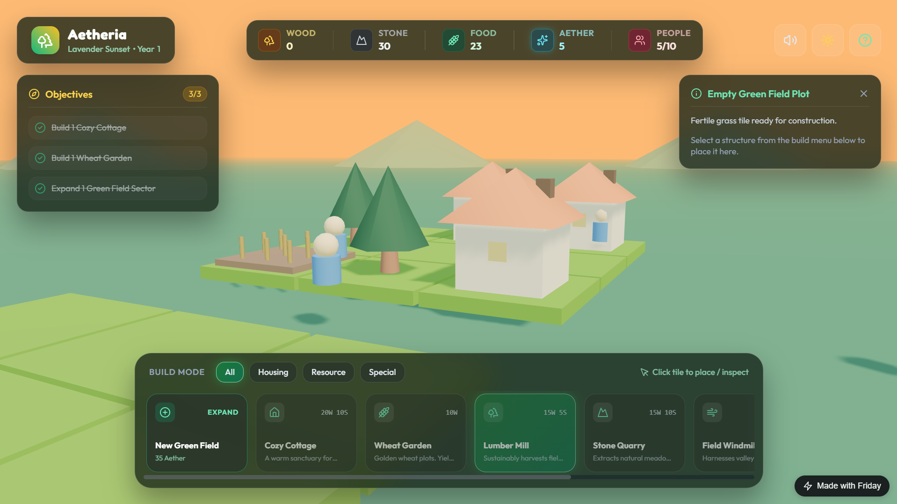

# Module 02: Build a Web App

## What changes when a site becomes a product

A landing page presents information. A full-stack product also accepts input, remembers data, identifies users, and enforces permissions. “Full stack” means its interface and behind-the-scenes services work together.

The goal is a focused micro-SaaS or useful tool that a small group can actually use. Examples from the course outline include a niche directory with submissions and admin approval, a personal CRM or deal tracker, a freelancer client portal, and a Living Style Guide Generator that analyzes a brand website plus Figma and produces an interactive component library. These are examples to learn from, not promises that every integration or analysis happens automatically.

Friday can help plan and build, connect a backend, iterate on the interface, work with GitHub, and support deployment. You decide the data model, review permissions, test journeys, and understand what you publish. Labels and options may vary by version.

### Worked example: a small playable web game

A browser game makes the difference concrete: the interface displays the board, the player supplies input, and the app updates the game state. It is also a useful MVP test: can a player understand the goal, make a move, and see an immediate response? Keeping this first version focused on that loop makes the core experience testable before adding secondary features.

**aetheria.tryfriday.app**

*Example project: aetheria.tryfriday.app — a focused, playable web experience.*

## 1. Scope a complete but small MVP

An MVP is a minimum viable product: the smallest version that delivers one meaningful outcome to a defined user. It is not a broken prototype, and it is not every feature you hope to build later. Choose a central task that someone can finish and judge whether it helped.

Consider a niche directory for independent ceramic studios. A first release might let a visitor browse approved studios by location, let a studio owner submit a profile, and let an administrator approve or reject that submission. It does not need messaging, bookings, reviews, payments, and a recommendation engine on day one.

Write a short brief:

- **User and situation:** Who opens the product, and when?
- **Core job:** What task should they complete?
- **Happy path:** What are the few steps from start to finish?
- **Data:** What information must be saved, and why?
- **Permissions:** Who can read, add, change, or approve each record?
- **Out of scope:** Which tempting features are deliberately postponed?
- **Proof:** What behavior would show this is useful?

Make roles explicit: visitors browse approved entries, submitters create pending ones, and administrators review them. State this before code generation.

## 2. Ask for a plan, then make the architecture understandable

The outline names Next.js, React, or Vite; TypeScript; Tailwind; and Supabase for authentication, database, and edge functions. Ask Friday to explain its stack choice and avoid unnecessary tools.

Give Friday a structured request such as:

> Build a responsive directory MVP for local bicycle repair shops. Visitors can search approved shops by town and view a detail page. Authenticated shop owners can submit a profile that remains pending until an admin approves it. Use the simplest stack in this project that fits the requirements. Propose screens, data tables, user roles, and access rules before coding. Do not add payments or messaging. Explain any assumptions and how I can test the permissions.

Review screens and data first. A shop record might need name, location, owner identity, review status, and timestamps. Ask why each field is needed and how visitors, owners, and administrators differ.

Build in milestones: browsing, submission, moderation, then visual refinement. After each, run the app, test behavior, and ask for changed files and remaining risks.

## 3. Understand the frontend and backend boundary

The frontend is what a person uses: pages, forms, lists, and navigation. The backend holds persistent records and trusted operations. TypeScript can catch some mistakes during development; Tailwind is a styling approach; React, Next.js, and Vite help structure web projects. Understanding their roles helps you ask useful questions.

Anything delivered to a browser can be inspected. Keep privileged database and payment credentials out of client code. Ask which operations run in the browser versus a trusted server or edge function, and where environment variables are used.

This walkthrough shows integrations in Friday Code. Check the current connection flow and permissions in your own project before granting access.

<video controls playsinline preload="metadata" aria-label="Integrations in Friday Code">
  <source src="Videos/Friday%20Code-Integrations-Dark.mp4" type="video/mp4">
  Your browser does not support embedded video. <a href="Videos/Friday%20Code-Integrations-Dark.mp4">Open the video</a>.
</video>

An edge function is server-side code that can perform a trusted operation without exposing its secret to the browser. For example, a directory might use one to send an administrator a submission notice. Keep the function narrow: validate input, check authorization, and return only what the client needs. Ask Friday what input it accepts, what identity it checks, and how errors are reported.

Before connecting Supabase, ask for the proposed tables, relationships, and access rules. Authentication answers “who is this user?” Authorization answers “what is this user allowed to do?” A signed-in user is not automatically an administrator. Public data, private profile data, and administrative actions should have distinct permissions. Review row-level access policies and test them using different roles. Do not assume that hiding an admin button is sufficient protection.

Use test records. Confirm users cannot edit others' submissions, anonymous visitors cannot read private data, and pending entries stay hidden. Test unusual inputs as well as the happy path. Ask for the verification method, not merely an assurance that the app is secure.

## 4. Design by observing the real interaction

The Visual Design Editor, also called Design Mode in the outline, is intended for fast UI iteration without repeatedly re-prompting for every visual adjustment. Try it after the key flow exists. Ask for a clear outcome such as increasing spacing around a form, making an action easier to find, or improving contrast. Avoid changing multiple unrelated visual elements at once.

A visual editor cannot fix a confusing user journey. Ensure users know where to start, what fields mean, and what submit does. Use persistent labels and useful loading, empty, error, and success states.

The outline mentions screen sharing and website cloning for inspiration or redesign. Study layout and interaction patterns, but do not copy logos, text, or distinctive assets. Ask for observations and opportunities, then create an original interface.

Test at desktop and mobile widths. Check keyboard navigation, visible focus, text contrast, readable font size, and labels for assistive technology. Ask a person unfamiliar with the project to complete the central task without coaching. Observe where they hesitate. Their confusion is design feedback, not a reason to blame the user.

## 5. Use GitHub and version history deliberately

Connecting GitHub gives the project a remote, version-controlled home. A commit is a checkpoint. Confirm repository, owner, visibility, and branch; do not publish credentials or private customer data.

Make checkpoints around meaningful changes. Version history helps recovery but does not replace backups or secret handling. Review risky changes before proceeding.

Avoid simultaneous agents editing the same files without coordination. Parallel work can help when one agent reviews copy, another checks accessibility, and another researches user needs. It can create conflicts when two agents rewrite the same component. Assign ownership and ask each agent to report its changes.

Before a checkpoint, confirm it contains the intended changes rather than secrets, test exports, or unrelated files. A useful checkpoint says what changed, such as “add submission and pending status,” not simply “updates.” If something breaks, compare the last known-good checkpoint and isolate the change instead of rewriting the entire application.

## 6. Deploy a useful product, not just a successful build

Deploy through the supported workflow. Confirm the branch, environment, and build result; controls may vary. Test the live app because forms, policies, or missing variables can fail after a successful build.

Create a short acceptance checklist for each role. For a moderated directory:

1. A visitor can find and open an approved entry.
2. A visitor cannot see a pending entry or private owner data.
3. A new owner can sign up, sign in, and submit a profile.
4. The submitter sees a clear pending status and cannot approve their own entry.
5. An administrator can review and approve a submission.
6. The approved entry then appears in public search.
7. Invalid form data produces a useful correction message.
8. A failed save does not falsely show success.

Ask a few target users to try one task each. Watch without explaining. Fix the obstacle that prevents completion before polishing minor details. Collect only the feedback you need and avoid putting confidential information into test tools.

## 7. Add user accounts without creating a support problem

Authentication supports private records and role-specific actions, but adds signup friction and responsibility for recovery, sessions, privacy, and support. Let visitors explore first if possible.

With Supabase authentication, align database rules with roles. Do not store passwords yourself. Test signup, login, logout, invalid credentials, and recovery; ensure one user's data does not remain visible after another signs in.

Before inviting customers, explain how to report problems or request data removal, and define how administrative access is granted.

## 8. Treat Stripe as a real financial integration

Stripe appears in the outline for basic payments. Payment work includes failures, refunds, customer expectations, and legal obligations. Do not collect card numbers yourself; use supported checkout and test without real charges first.

Ask how payment is confirmed. Do not grant access because a browser reports success. Keep secret keys server-side, handle canceled, failed, or refunded payments, and clearly show amount, renewal terms, and cancellation.

Start without payments unless needed to validate the product. A small manual pilot may teach more than unfinished billing. Get appropriate advice on legal, tax, and consumer obligations.

## 9. Invented use case: Living Style Guide Generator

The outline describes a Living Style Guide Generator that analyzes a brand's website plus Figma and produces an interactive component library. Treat this as an ambitious example, not a guaranteed one-click capability. Break it into a first safe experiment: a user supplies a public website address and perhaps a design file they have permission to use; the product extracts a small set of colors, type styles, and buttons; the user reviews the results before saving a guide.

Be explicit about what can and cannot be inferred from a website. Automated extraction may miss responsive states, hidden screens, licensing information, or intended component behavior. A result should be presented as a draft, not an authoritative design system. Ask for permission before processing private design files, and do not expose one customer's source material to another. Start by testing with your own brand or a consenting participant.

The first product question is not “Can we analyze everything?” It is “Does a designer save time getting a usable starting inventory of styles?” Build the smallest workflow that answers that question. Store only the outputs needed to display the guide, allow correction, and provide a clear way to remove an uploaded project.

## Common mistakes and practical safeguards

- **Designing tables before clarifying the user journey.** Data should support a task, not dictate the product.
- **Treating authentication as authorization.** Verify permissions for each role and each record.
- **Putting secrets in frontend code.** Keep privileged credentials on trusted server-side systems.
- **Using production data for experiments.** Make test accounts and synthetic data first.
- **Adding Stripe too early.** Validate the core value before taking on billing and support.
- **Copying a competitor.** Learn from patterns, then create original content and visuals.
- **Testing only as an administrator.** Test anonymous visitors and ordinary accounts too.
- **Trusting a successful build alone.** Run real user journeys against the deployed app.
- **Accepting unclear agent claims.** Ask for an explanation, file summary, and reproducible test.

## Project exercise: Build a niche directory

Build a directory for one narrowly defined community, such as independent bicycle repair shops in a few neighborhoods or accessible coworking spaces in one city. The project is intentionally focused. Public visitors browse approved listings. A contributor submits a listing. An administrator reviews it. You may choose a different micro-SaaS from the outline, but preserve the same discipline: one central user outcome, explicit permissions, and a deployable first version.

**Workflow**

1. Interview or message at least three potential users. Ask how they solve the problem now and what information they trust.
2. Write the audience, main task, out-of-scope features, and acceptance checklist.
3. Ask Friday for a proposed architecture, screen list, data model, and access-control plan. Review each before authorizing a build.
4. Implement browsing first, then submission and moderation. Use synthetic data and accounts while developing.
5. Test permissions for anonymous, contributor, and administrator roles. Confirm pending submissions remain private.
6. Use Design Mode to address one observed usability issue. Check the page at phone and desktop widths.
7. Connect GitHub, create clear checkpoints, and deploy a test version.
8. Invite a few target users to complete the main task. Record where they hesitate and make one evidence-based improvement.

**Copy/paste prompt**

> Help me build a small directory for [specific audience] in [location or niche]. Visitors should [main task], contributors should [submission task], and an administrator should [review task]. First return a short plan with screens, data fields, roles, access rules, assumptions, and acceptance tests. Do not change files until I approve the plan. Then implement one milestone at a time, using test data, and report the files changed and how each role's permissions can be verified. Keep [out-of-scope features] out of the first version.

**Success criteria**

- A visitor can complete the main public task without an account.
- A contributor can submit a record and see its review state.
- Only an authorized administrator can approve or reject a record.
- Users cannot read or edit other users' private information.
- Forms have useful validation, loading, success, and error states.
- The deployed app works with production-like configuration and contains no exposed secrets.
- You have documented at least one piece of user feedback, one remaining risk, and the next feature you will not build yet.

Your code does not need to be perfect or large. It should be understandable enough to inspect, safe enough for a small controlled test, and focused enough that feedback can change the next decision.

## Quick-start checklist

### What you are building

- Turn a single useful workflow into a small full-stack product with clear roles and real data.
- Choose one central job instead of adding features before the workflow is proven.
- Separate public browsing, user actions, and admin review with explicit permissions.
- Test actual data flow, not just a pretty interface or a successful build.

### Your workflow in 6 easy steps

1. Scope a small MVP around one complete user task and one measurable outcome.
2. Write the audience, roles, permissions, and out-of-scope features before coding.
3. Ask for a rough screen and data model so structure is visible before implementation.
4. Build browse, submit, and review flows in small milestones.
5. Test what visitors, contributors, and admins can each view and do.
6. Deploy a working version and collect real feedback on the core workflow.

### Checklist
- User and problem are clear
- Scope is narrow enough to test
- Core workflow is defined before extra features
- Real validation happens before launch
- A next improvement is recorded for the next cycle

> Pro tip: treat every module as a build-test-learn loop. The goal is not perfection, it is clarity, evidence, and a usable result that can be improved with the next test.

